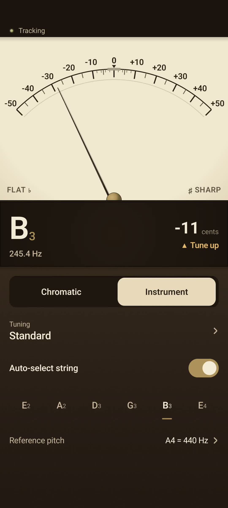

<p align="center">
  
</p>

<h1 align="center"> Resonance</h1>

<p align="center">
  Offline chromatic guitar tuner for Android — a vintage analog-meter instrument
  with a calm, readable display.<br>
  No login, no ads, no analytics, no network.
</p>

<p align="center">
  <a href="https://github.com/sk3y04/resonance-guitar-tuner/actions/workflows/ci.yml"></a>
  <a href="LICENSE"></a>
  <a href="https://github.com/sk3y04/resonance-guitar-tuner/releases/latest"></a>
</p>

Microphone audio is processed on-device and never stored or transmitted.
Built with Kotlin Multiplatform: a shared pitch-detection engine and Compose UI,
plus a thin Android shell.

## Demo

<p align="center">
  <a href="docs/assets/resonance-demo.webm" title="Watch the Resonance demo (WebM, 22 s)">
    
  </a>
</p>

<p align="center"><em>▶ 22-second screen recording (WebM, 1080×2400): live tuning in instrument mode — click the image to play.</em></p>

## Status

First public release (`1.0.0`) — grab the APK in [Download](#download).
Heavily tested on the JVM host; the UI has been verified on an Android 15 phone
and an API 36 emulator. The automated real-microphone device suite is
compile-checked on every CI run but has not yet been run green on hardware.
Development log: [`docs/STATE.md`](docs/STATE.md).

## Download

**[resonance-1.0.0-debug.apk](https://github.com/sk3y04/resonance-guitar-tuner/releases/download/v1.0.0/resonance-1.0.0-debug.apk)**
— Android 8.0+ (minSdk 26). All releases:
[v1.0.0](https://github.com/sk3y04/resonance-guitar-tuner/releases/tag/v1.0.0) ·
sha256 and build metadata in the release notes.

```sh
adb install -r resonance-1.0.0-debug.apk
```

Or copy the APK to the phone and open it (allow installs from unknown sources).
This first public build is **debug-signed**: the project has no release signing
config yet ([`docs/development.md`](docs/development.md)). It is fully
functional and offline; a future release-signed build will need a fresh install
because the signatures differ.

**Contents:**
[Download](#download) ·
[Features](#features) ·
[Requirements](#requirements) ·
[Quick start](#quick-start-no-phone-needed) ·
[Build & install](#build-and-install-the-android-app) ·
[Usage](#usage) ·
[Project structure](#project-structure) ·
[Tests](#tests) ·
[Limitations](#known-limitations) ·
[Troubleshooting](#troubleshooting) ·
[Development](#development) ·
[Privacy](#privacy) ·
[License](#license)

## Features

- **Chromatic + instrument modes** — any note in the ~55–1200 Hz design range,
  or preset string targets with automatic target-string selection and manual
  string lock.
- **Honest analog meter** — needle + digital readout (note, cents, frequency)
  with an in-tune zone on the dial. With no reliable pitch the needle fades out
  and the readout says so — never a fake reading.
- **Custom tunings** — create/edit/delete, favorites, and versioned-JSON
  import/export through the Android document picker, on top of built-in presets.
- **Reference pitch** — A4 adjustable 400–480 Hz in 0.1 Hz steps (steppers or
  direct entry).
- **Spelling preference** — sharp / flat / natural accidental spelling.
- **Quiet by design** — on-device persistence (DataStore), reduced-motion
  support, predictive back, and no network permission at all.

## Requirements

| Need | Version / note |
|---|---|
| Android (to run the app) | 8.0+ (minSdk 26, targetSdk 36) |
| JDK (to build) | 21 |
| Android SDK | at least one installed platform — needed for the app and the Android gates; without it the JVM tests and demo still build and run (Android target auto-disabled, [ADR-003](docs/DECISIONS.md)) |
| Build host | Linux x64 tested; headless Compose UI tests use a linux-x64 skiko runtime, other hosts are untested |

## Quick start (no phone needed)

With JDK 21 installed:

```sh
./scripts/run-demo.sh
```

Runs the full pipeline — synthetic microphone → pitch detection → engine →
UI state — as 5 assertive scenarios. Expected result: `5/5 scenarios passed`.

## Build and install the Android app

1. Install JDK 21 and an Android SDK with a platform (Android Studio, or
   `sdkmanager`). Point the build at it:

   ```sh
   export ANDROID_HOME=/path/to/android-sdk
   # or: echo "sdk.dir=/path/to/android-sdk" > local.properties
   ```

2. Build the debug APK:

   ```sh
   ./scripts/build-debug.sh
   ```

   Produces `artifacts/resonance-debug-<date>.apk` and
   `artifacts/LATEST_BUILD.txt` (sha256, source commit, size).

3. Install and run:

   ```sh
   adb install -r artifacts/resonance-debug-<date>.apk
   ```

   Launch Resonance, allow the microphone when prompted, and pluck a string.

Direct Gradle tasks (the Gradle 9.7.0 wrapper is included, distribution
sha256-pinned; dependency versions pinned in `gradle/libs.versions.toml`):

```sh
./gradlew :shared:jvmTest            # shared host tests
./gradlew :hostDemo:run              # full-pipeline demo
./gradlew :androidApp:assembleDebug  # debug APK (needs Android SDK)
./scripts/verify.sh                  # the full gate suite
```

## Usage

- **Pluck a string** — the needle shows cents deviation around the target; the
  readout shows note name, cents, and frequency. No reliable pitch → the needle
  fades out and the readout says so.
- **MODE key** — switches Chromatic / Instrument. In instrument mode the target
  string is selected automatically; tap a string key to lock it manually.
- **Gear key** — settings: preset selection and favorites, A4 calibration
  (±1 Hz / ±0.1 Hz steppers or direct numeric entry, reset to 440), accidental
  spelling, and a Manage area with the custom-tuning editor and import/export.
- **Persistence** — custom tunings, favorites, and settings survive restarts.
  Export writes a versioned JSON file that can be re-imported on any device.

## Project structure

```text
├── shared/                  # KMP module — essentially the whole product
│   └── src/
│       ├── commonMain/      # pitch engine (YIN), tuner state machine,
│       │                    # presets/settings, Compose UI
│       ├── jvmMain/         # host actuals (capture/file seams for demo+tests)
│       ├── androidMain/     # Android actuals (capture, DataStore, bridge)
│       ├── commonTest/      # shared suite — runs on JVM AND Robolectric
│       ├── jvmTest/         # JVM-only: DSP matrix, fuzz, headless Compose
│       └── androidHostTest/ # Robolectric bridge behavior tests
├── androidApp/              # thin Android shell: ResonanceApp activity,
│                            # permission/lifecycle policy, manifest, androidTest
├── hostDemo/                # executable full-pipeline demo (synthetic mic,
│                            # virtual clock; exits non-zero on any failure)
├── scripts/                 # build / test / verify gates (see Tests)
├── docs/                    # architecture, ADRs, quality reports, dev log
│   └── assets/              # logo, banner, demo video
└── gradle/                  # wrapper + libs.versions.toml (pinned versions)
```

The Android target is conditionally enabled: `settings.gradle.kts` includes
`:androidApp` only when `ANDROID_HOME` (or `ANDROID_SDK_ROOT`) points at an SDK
with an installed platform, so JVM development is never blocked by a missing
SDK. Data flow, threading contract, and extension points:
[`docs/development.md`](docs/development.md).

## Tests

| Command | What it covers | Requires |
|---|---|---|
| `./scripts/test-unit.sh` | 454 shared JVM tests: DSP correctness matrix, fuzz/property suites, state machine, persistence, UI mappers, headless Compose | JDK 21 (Linux x64 for render tests) |
| `./scripts/test-ui.sh` | Headless Compose semantics + render-smoke subset | JDK 21, Linux x64 |
| `./scripts/run-demo.sh` | Full-pipeline demo, 5 assertive scenarios | JDK 21 |
| `./scripts/verify.sh` | 7 gates: unit tests, demo, offline-contract, lint, debug assembly, Robolectric host tests (383), instrumented test APK compile | JDK 21; Android SDK for gates 3–7 |
| `./scripts/test-device.sh [serial]` | On-device suite: real-mic smoke, persistence, app launch. Opt-in; grants RECORD_AUDIO via `pm`; never wipes a device | Attached device/emulator |

Counts are from a local run on 2026-11-19 (Linux x64, Temurin 21).
`verify.sh` reports missing-prerequisite gates as `BLOCKED` — never as green —
and fails if any available gate fails. A test run that discovers zero tests is
treated as a failure, not a pass. Test logs land in `artifacts/logs/`.

## Known limitations

- Monophonic tuning only; design range ~55–1200 Hz. Polyphony/chords, reference
  tones, and bass/extended-range guarantees are out of scope.
- Documented low-register stress limit under heavy noise (10 dB SNR); a mix in
  which another string is louder than the played note is refused rather than
  guessed. Measurements: [`docs/QUALITY_REPORT.md`](docs/QUALITY_REPORT.md).
- One-octave sympathetic-bleed recovery only.
- Accuracy evidence is synthetic plus limited on-device UI verification; the
  automated real-mic suite has not yet been run green on hardware.

## Troubleshooting

| Symptom | Fix |
|---|---|
| `[verify] BLOCKED: ...` | Android SDK missing or not visible. Set `ANDROID_HOME` (or `local.properties`) with at least one installed platform. JVM gates still run without it. |
| App shows "Open app settings" | Microphone permission was permanently denied; grant it in Android's app settings. |
| Headless UI test failures on macOS/Windows | The pinned skiko runtime is linux-x64; use Linux x64 (or WSL2). |
| A test run discovers zero tests | Treated as a failure, not a pass — check the log in `artifacts/logs/`. |

## Development

- Architecture, testing strategy, manual release process:
  [`docs/development.md`](docs/development.md)
- Toolchain rationale and verified dependency metadata:
  [`docs/DECISIONS.md`](docs/DECISIONS.md), [`docs/DEPENDENCIES.md`](docs/DEPENDENCIES.md)
- Contribution workflow (setup, component map, PR and commit expectations):
  [`CONTRIBUTING.md`](CONTRIBUTING.md)

## Privacy

Microphone audio is processed on-device and never stored, transmitted, or
logged; no recordings are retained. The merged manifest is enforced by
`scripts/check-offline-contract.sh` to contain only `RECORD_AUDIO` (plus one
AGP-injected package-private receiver permission) — no INTERNET, no
network-adjacent permissions, no cleartext traffic.

## License

GPL-3.0-only — GNU General Public License version 3, **without** the
"or (at your option) any later version" option.

Copyright (c) 2026 Edgar Tadevosyan.

Full license text: [LICENSE](LICENSE). SPDX identifier: `GPL-3.0-only`.